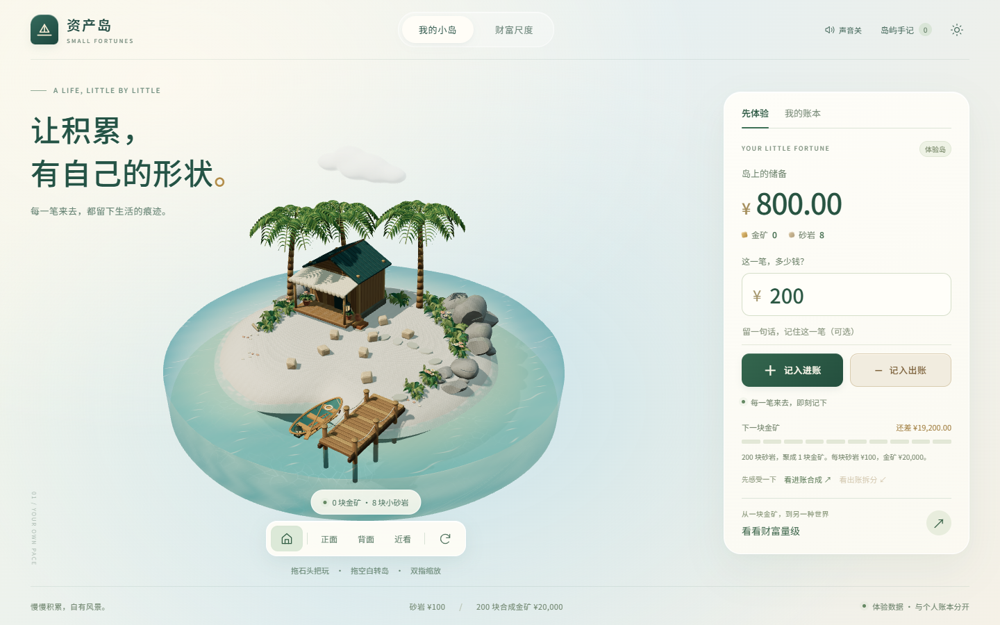
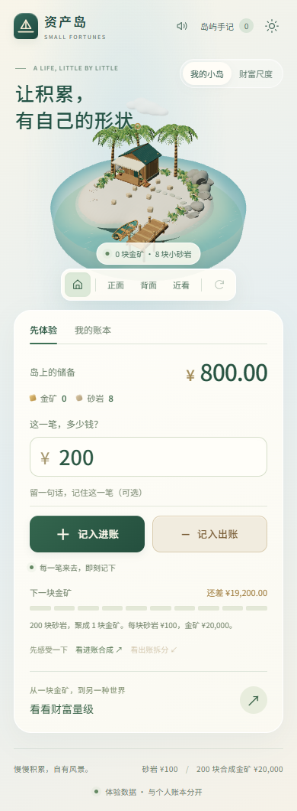
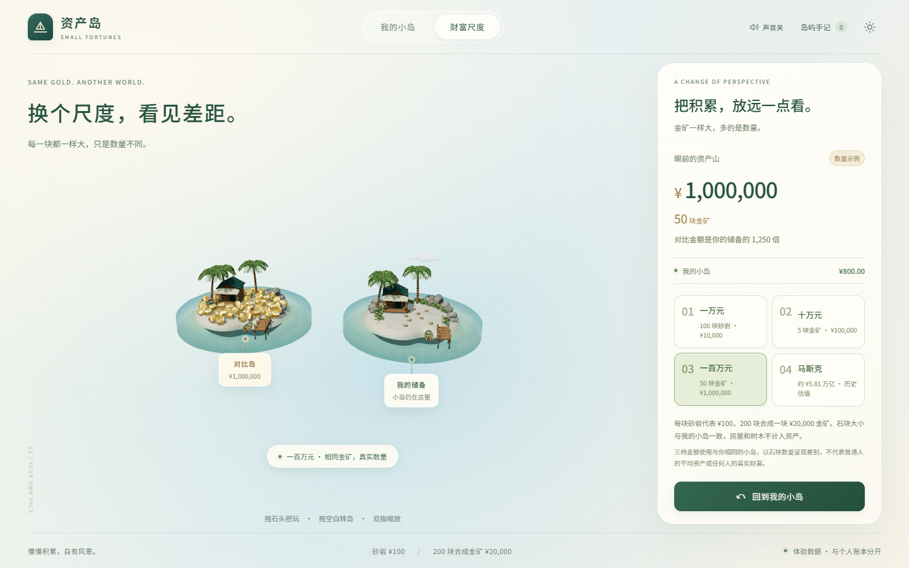

# 资产岛 · Small Fortunes

一个可以记账、把玩和比较财富尺度的 3D 小岛。收入化为落在岛上的砂岩，支出取走砂岩；每 200 块砂岩（¥20,000）聚合为一块金矿。个人账本保存在浏览器本地，不需要账号或服务器。

**在线体验：** [small-fortunes-island.flowymule11.chatgpt.site](https://small-fortunes-island.flowymule11.chatgpt.site/)

**版本：** v0.9.0



## 功能

- 体验模式可观察砂岩落岛、聚合和支出拆分；个人模式支持精确到分的收入、支出、备注及起始余额。
- 本地账本支持撤销、更正、JSON 备份导出与校验后导入。体验数据与个人数据分开保存。
- 拖动石块、环绕和缩放场景；场景使用真实地形碰撞。可切换画质、减少动态效果以及开关声音。
- 财富尺度展示 ¥10,000、¥100,000、¥1,000,000 和带明确历史日期的巨量估值。普通示例使用与个人岛同尺寸的岛，差异由储备数量表现。
- WebGL 不可用时仍可使用账本。没有云同步、银行连接或投资行情。




## 本地运行

需要 Node.js 24 或兼容版本。项目锁定了依赖版本。

```bash
npm ci
npm run dev
```

打开 <http://127.0.0.1:5186/>。开发服务固定使用本机 5186 端口；已有服务占用该端口时会报错，不会自动换端口。

正式构建和预览：

```bash
npm run build
npm run preview
```

预览固定使用 <http://127.0.0.1:5187/>。`dist/` 是静态构建产物，需要通过 HTTP(S) 服务访问，不能直接双击 HTML 文件运行。`npm run build` 会先校验并同步 `assets/runtime/` 中的模型到 `public/generated/`。

## 验证

```bash
npm run typecheck
npm run lint
npm test
npm run build
node scripts/check-glb.mjs
```

浏览器专项检查使用 Playwright 和本机 Chrome，部分脚本要求开发服务已经运行；命令和端口约定可查看 `package.json` 与对应脚本。浏览器视口模拟不等于手机真机测试。3D 性能也取决于设备、浏览器和显卡。

## 项目结构

| 路径 | 内容 |
| --- | --- |
| `src/app` | 页面、账本表单、手记与对话框 |
| `src/domain`、`src/storage` | 金额规则、流水、更正、备份和本地持久化 |
| `src/scene`、`src/audio` | Three.js 场景、物理交互、财富对比和声音 |
| `assets/source`、`assets/runtime`、`assets/manifests` | 原创 Blender 源文件、运行时模型和校验清单 |
| `scripts` | 模型生成、资产校验和自动验证脚本 |
| `public/licenses` | 字体及第三方生产依赖的版权和许可原文 |

个人账本仅在当前浏览器的本地存储中。公开体验站与本地开发地址的存储彼此独立；清除浏览器数据或换设备前，请在「岛屿手记」中导出备份。

## 版权与使用范围

本仓库公开供查看、克隆和学习。**本项目原创代码、模型、纹理与文案未授予修改后再发布或商业使用的许可。** 如需这些用途，请先取得仓库所有者授权。仓库公开不改变其中第三方组件的许可；字体和生产依赖的许可与版权声明见 [`public/licenses/`](public/licenses/README.txt)。

公开源码中不包含个人账本数据或设计参考图。仓库保存的是 v0.9.0 正式应用源码及必要的验证脚本；早期内部交接资料和实验场景没有纳入本次公开版本。
